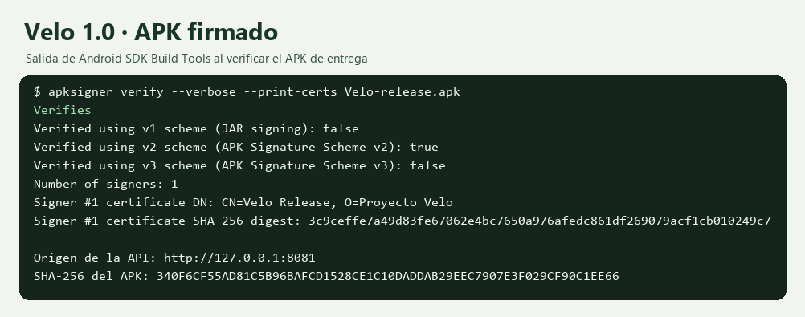

# Velo App

Velo conecta a productores agrícolas y aplicadores. Un productor publica una solicitud de aplicación con la superficie, el turno, los obstáculos y las fotos del terreno. Un aplicador consulta las solicitudes disponibles y ofrece un precio por hectárea. El productor revisa las ofertas y acepta una.

## Arquitectura

- `Velo/` contiene la app Android en Kotlin y Jetpack Compose. Las pantallas manejan acciones del dispositivo y los ViewModels administran formularios, sesión y estados de carga.
- Los repositorios conectan los ViewModels con Room en modo local o con la API propia mediante Retrofit. Cada modo tiene su propio almacén.
- `backend/` contiene la API Spring Boot y la base H2 persistente. El servidor autentica con tokens temporales y valida el rol y la propiedad en las operaciones protegidas.
- La consulta de clima usa Retrofit con Open-Meteo de forma independiente de la API propia. Desde el formulario de solicitud se abre la pantalla **Clima** para buscar una localidad y consultar sus condiciones y viento.

La app usa la cámara durante el registro, el selector de documentos para adjuntar fotos del terreno y el selector de fotos para editar el perfil. El lanzador utiliza el ícono adaptativo de Velo.

## Ejecutar en desarrollo

1. Abre `Velo/` en Android Studio con JDK 21 y SDK 37.1. Para trabajar únicamente con Room, ejecuta la app con la configuración predeterminada.
2. Inicia el servidor en otra terminal. El servicio escucha en el puerto `8081`.

   ```powershell
   cd backend
   .\mvnw.cmd spring-boot:run
   ```

3. Para probar la app en modo remoto con un teléfono conectado por ADB, configura el reenvío y pasa la URL al proyecto Android.

   ```powershell
   adb reverse tcp:8081 tcp:8081
   cd Velo
   .\gradlew.bat :app:installDebug "-PveloApiUrl=http://127.0.0.1:8081"
   ```

   En el emulador oficial puedes usar `-PveloApiUrl=http://10.0.2.2:8081`. Para un servidor externo, usa su URL HTTPS. La app agrega el prefijo `/api/v1`.

4. Registra cuentas distintas para productor y aplicador. Con el productor, publica una solicitud, edítala mientras esté libre de ofertas y prueba eliminar otra solicitud de prueba. Con el aplicador, abre la solicitud activa y envía una oferta. En la cuenta del productor, revisa las ofertas y acepta una.

## Endpoints

La app llama a la API propia bajo `/api/v1`. El [README del backend](backend/README.md) incluye el contrato HTTP y la configuración de la base de datos.

| Método | Ruta | Uso |
| --- | --- | --- |
| POST | `/auth/register` | Crear cuenta |
| POST | `/auth/login` | Iniciar sesión |
| GET | `/solicitudes` | Listar solicitudes |
| POST | `/solicitudes` | Publicar solicitud |
| GET | `/solicitudes/{id}` | Consultar el detalle |
| PUT | `/solicitudes/{id}` | Editar una solicitud propia sin ofertas |
| DELETE | `/solicitudes/{id}` | Eliminar una solicitud propia sin ofertas |
| GET | `/solicitudes/{id}/ofertas` | Consultar ofertas |
| POST | `/solicitudes/{id}/ofertas` | Enviar oferta |
| POST | `/solicitudes/{id}/aceptacion` | Aceptar oferta |
| POST | `/perfil/foto` | Cambiar foto de perfil |

La consulta externa usa [Geocoding API](https://open-meteo.com/en/docs/geocoding-api) con `GET /v1/search` para buscar localidades y [Weather Forecast API](https://open-meteo.com/en/docs) con `GET /v1/forecast` para mostrar el tiempo actual.

## Pruebas

Desde `Velo/`, ejecuta las pruebas unitarias y genera el informe de cobertura de Android.

```powershell
.\gradlew.bat :app:testDebugUnitTest :app:createDebugUnitTestCoverageReport
```

El informe se genera bajo `Velo/app/build/reports/coverage/`. La verificación de entrega registró 35 pruebas unitarias de Android aprobadas y 80,87 % de cobertura de líneas en ViewModels y repositorios combinados (630 de 779 líneas).

Desde `backend/`, ejecuta las pruebas HTTP y de persistencia del servicio Spring Boot.

```powershell
.\mvnw.cmd test
```

Las 3 pruebas de integración de Spring Boot pasaron. La comprobación HTTP verificó las 11 operaciones que usa la app y el endpoint de salud con datos de prueba.

[Tablero VeloApp en Trello](https://trello.com/b/gBI1NmLN)

## Generar y verificar el APK firmado

Usa JDK 21, Android SDK 37.1 y un almacén JKS privado. Configura estas variables de entorno en la terminal de compilación.

| Variable | Valor |
| --- | --- |
| VELO_SIGNING_STORE_FILE | Ruta absoluta del archivo JKS |
| VELO_SIGNING_STORE_PASSWORD | Contraseña del almacén |
| VELO_SIGNING_KEY_ALIAS | Alias de la clave |
| VELO_SIGNING_KEY_PASSWORD | Contraseña de la clave |

La versión de entrega se conecta a Spring Boot por USB. Desde la carpeta Velo, genera el release con la dirección local de la API.

    .\gradlew.bat --no-configuration-cache :app:assembleRelease "-PveloApiUrl=http://127.0.0.1:8081"

El APK firmado se genera en Velo/app/build/outputs/apk/release/app-release.apk. Verifica la firma con apksigner de Android SDK Build Tools.

    apksigner verify --verbose --print-certs .\app\build\outputs\apk\release\app-release.apk

La clave de firma y sus contraseñas se guardan fuera del repositorio. El JKS de Velo usa el alias `velo-release`.

Huella SHA-256 de `Velo-release.apk` para comparar el archivo entregado. `340F6CF55AD81C5B96BAFCD1528CE1C10DADDAB29EEC7907E3F029CF90C1EE66`



### Ejecutar el APK de entrega en un teléfono Android

1. Desde la raíz del repositorio, abre una terminal para Spring Boot y déjala abierta.

       cd backend
       .\mvnw.cmd spring-boot:run

2. Confirma que la API responde en el PC. En otra terminal, ejecuta:

       Invoke-RestMethod http://127.0.0.1:8081/api/v1/salud

3. En el teléfono, habilita la depuración USB, conéctalo con un cable de datos y acepta la autorización. Ejecuta ADB desde Android SDK Platform-Tools. Copia el número de serie del teléfono que aparece con estado device.

       adb devices -l
       $serial = 'SERIAL_DEL_TELEFONO'
       adb -s $serial reverse tcp:8081 tcp:8081
       adb -s $serial install -r 'RUTA_DEL_APK_FIRMADO'

4. Abre Velo y mantén el cable conectado y Spring Boot en ejecución. Registra cuentas distintas de productor y aplicador en la API. Publica una solicitud con el productor, envía una oferta con el aplicador y vuelve al productor para aceptarla. Vuelve a aplicar adb reverse si desconectas el USB.

## Autor

- Vicente Castro
